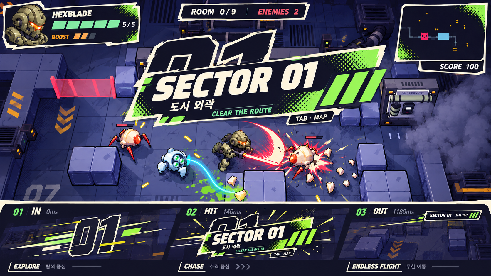
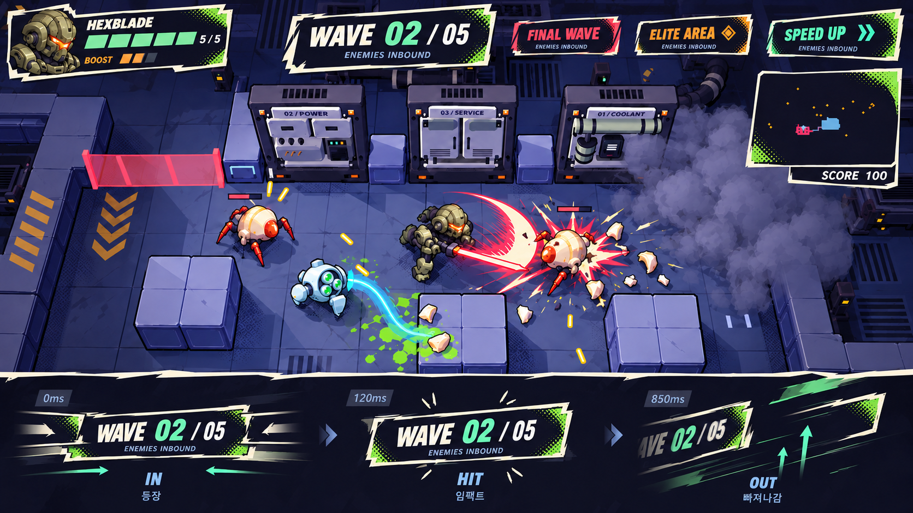
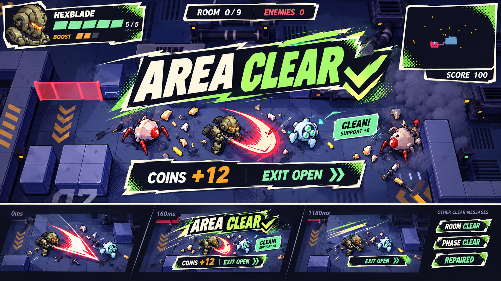
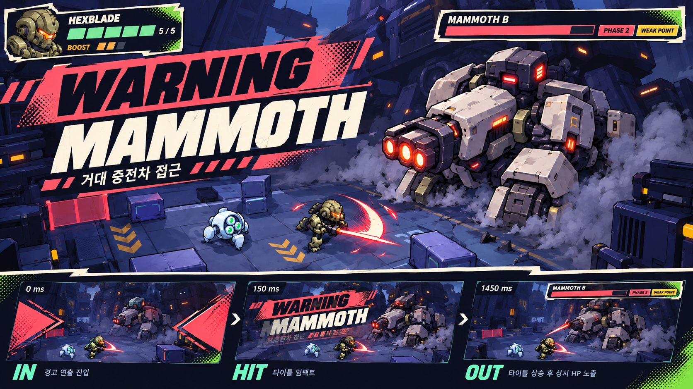
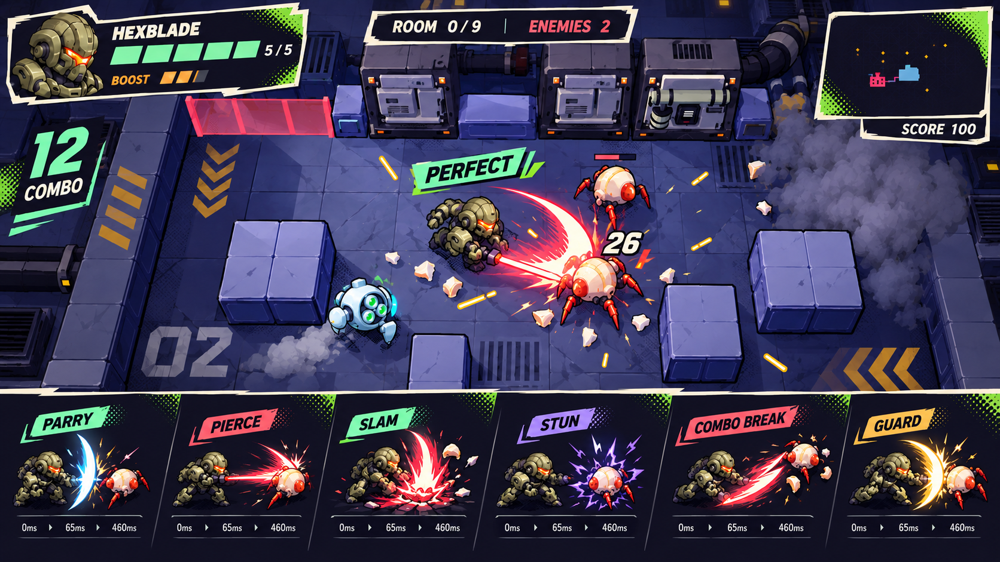
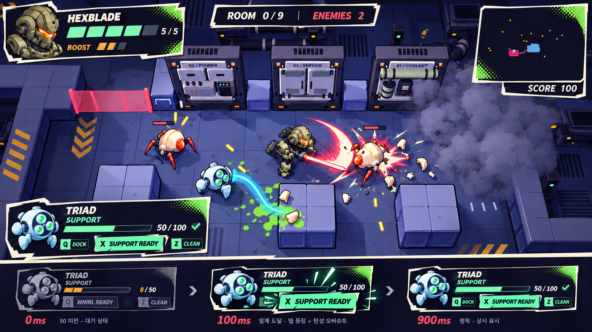
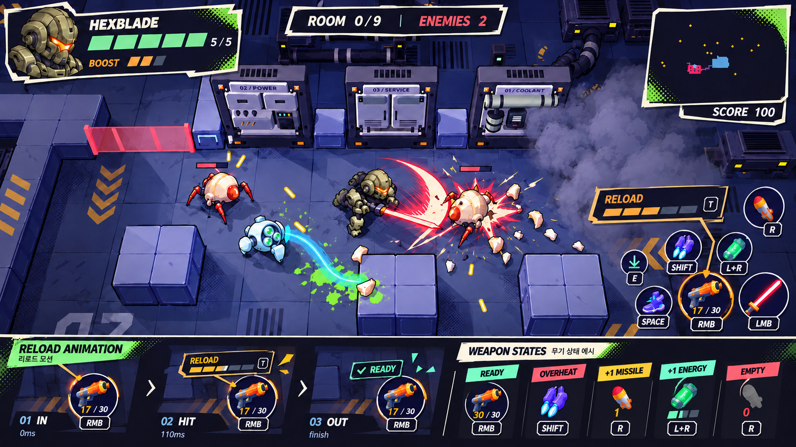
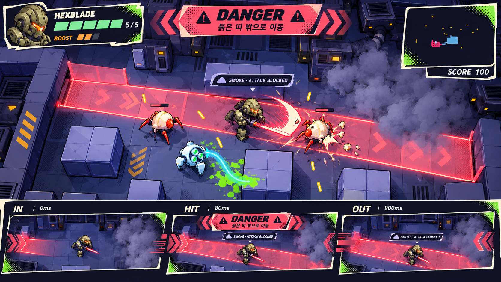
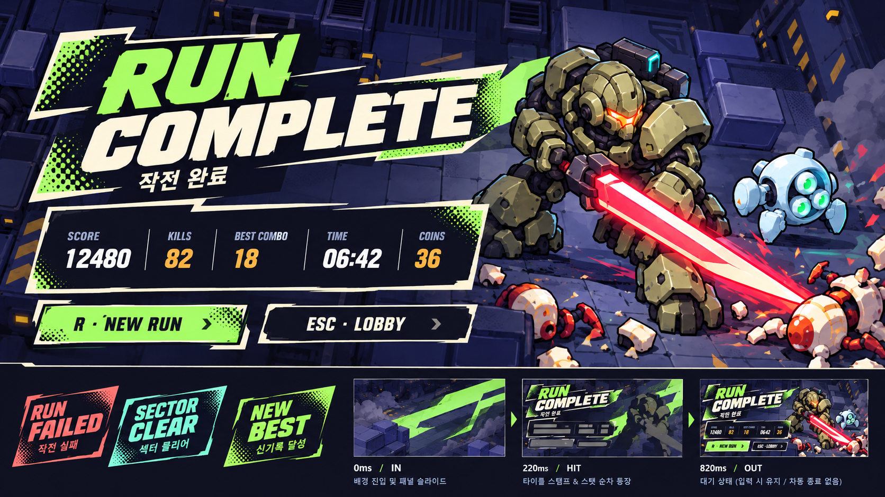
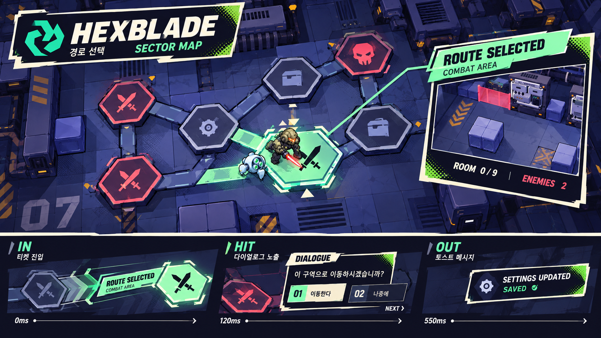

# HEXBLADE 알림·텍스트 UI 모션 컨셉
2026-10-11 · 제안 v1 · 게임 적용 전 검토본

사용자 요청: 채택된 Chroma 시안 스타일로 스테이지 시작과 게임 알림을 발전시키고, 쫄깃하고 스피디한 모션 그래픽 방향을 화면별 시안과 문서로 정리한다. **이번 산출물은 컨셉 이미지·스토리보드·독립 미리보기·설계 문서다. 게임 스크립트, 씬, 조작, 밸런스, 기존 합체 캐릭터는 변경하지 않는다.** 이 문서의 신규 문구·타이밍·팔레트·배치는 제안이며 사용자 확정값이 아니다.

## 1. 기준과 핵심 방향

- 채택 무드: [10월 5일 전투·청소](../chroma-major-screens-20261005/03_combat_cleanup.png), [10월 7일 로비](../lobby-upgrade-kit-20261007/preview_static_1920x1080.png).
- 이전 전투 UI 배치 4안은 비교 자료이며 최종 선택 기록은 없다. 이 작업은 배치 4개 중 하나를 새로 확정하지 않는다.
- 남보라 면 + 아이보리 잘린 테두리 + 라임 망점. 민트=사용 가능/청소, 코랄=위험/손실, 주황=자원/열, 라벤더=상태 제한.
- **한 번 압축 → 빠르게 꽂힘 → 작은 반동 → 읽는 동안 정지 → 사선으로 잘려 나감.** 느슨하게 계속 흔들리는 스프링은 쓰지 않는다.
- 몸통 패널·숫자·작은 설명은 각각 20~45ms 어긋나게 들어온다. 모든 글자가 동시에 확대되는 효과를 줄인다.
- 짧은 판 조각·2프레임 타이포 잔상·망점 마스크를 속도 표현으로 사용한다. 긴 빛 궤적·금빛 반짝이·화면 전체 흰 점멸은 신규 UI 문법에 넣지 않는다.
- 그림은 구성/질감 시안이다. 실제 적용 때 글자·숫자·게이지·포커스·키 배지는 엔진에서 다시 조판한다. 생성된 한국어의 오타나 비율을 명세로 읽지 않는다.
- 캐릭터 새 생성 없음. 기존 메카/드론 UI 참조만 사용하며 합체 인물과 원화는 보존한다.

## 2. 실제 코드 조사와 필요한 연출 목록

표의 **기존**은 이벤트·상태·정보가 현재 코드에 있다는 뜻이다. 새 디자인이나 모든 문구가 이미 구현되어 있다는 뜻이 아니다. **확장**은 현재 상태를 읽어 새 알림을 만드는 제안, **후속**은 해당 시스템 자체가 아직 확인되지 않은 제안이다. 개발 프리셋 변경 알림은 작고 조용한 시스템 토스트로 취급하며 본편 성취 알림과 분리한다.

| ID | 필요한 순간 / 제목 예 | 근거 파일·함수/상태 | 구분 | 시안 | 우선 |
|---|---|---|---|---|---|
| A01 | 첫 출격 SECTOR / EXPLORE | run_main.gd 시작 배너, main.gd _ready | 기존 | 01 | P0 |
| A02 | 추격 CHASE / FORGE / SHAFT / LAYER | boss_main·forge_main·spider_main·abyss_main 시작 | 기존 | 01 | P1 |
| A03 | 무한 비행 ENDLESS FLIGHT | stream_main.gd 시작 | 기존 | 01 | P1 |
| A04 | 전투/정예/정비 구역 진입 | run_main.gd 노드 종류별 배너 | 기존 | 02 | P0 |
| A05 | 차단막 닫힘 / 적 수 | main.gd 전투 진입, run_main.gd 전투 시작 | 기존 | 02 | P0 |
| A06 | WAVE n / FINAL WAVE | main.gd 다음 웨이브 | 기존 | 02 | P0 |
| A07 | 속도 상승 / 정예 접근 | stream_main.gd _set_sector | 기존 | 02 | P1 |
| A08 | ROOM CLEAR / AREA CLEAR | main.gd·run_main.gd 방 완료 | 기존 | 03 | P0 |
| A09 | 코인 보상 / 출구 개방 | run_main.gd _clear_room, Run.describe | 기존 | 03 | P0 |
| A10 | PHASE CLEAR / 지형 전환 | abyss_main.gd 단계 정리 | 기존 | 03 | P1 |
| A11 | REPAIRED / 장갑 회복 | run_main.gd 정비 발판 | 기존 | 03 | P1 |
| A12 | 보스 첫 등장 / 이름 | boss_main·forge_main·spider_boss·warden | 기존 | 04 | P0 |
| A13 | LANCASTER 연출 후 전투 | lancaster_intro·lancaster_boss intro_done | 기존+확장 제목 | 04 | P1 |
| A14 | PHASE 2 / 폭주 | spider_boss·warden·boss_enemy·forge_boss | 기존 | 04 | P0 |
| A15 | 약점 노출 / 피해 배율 | boss_enemy·forge_boss OVERHEAT, crawler WEAK POINT, lancaster WEAK×1.6 | 기존 | 04 | P0 |
| A16 | 부위 파괴 SEVER / CRUSH | warden·forge_boss 부위 파괴 | 기존 | 04/05 | P1 |
| A17 | PERFECT 정밀 회피 | player.gd PERFECT, danger_fx.gd | 기존 | 05 | P0 |
| A18 | PARRY 패링 성공 단어 | parry.gd _success의 판정/기존 연출에 작은 단어 추가 | 확장 | 05 | P0 |
| A19 | PIERCE / TEMPEST / SLAM | player·blade_tech·leap_slam 공격 팝업 | 기존 | 05 | P1 |
| A20 | 피해 숫자 / ×2 / GUARD / DEFLECT | moco_fx·damage_log, boss·crawler 팝업 | 기존 | 05 | P0 |
| A21 | 처치·타격 콤보 / 등급 상승 / 점수 정산 / COMBO BREAK | hud.gd combo_pop·combo_break, presentation/combo_meter.gd | 기존 | 05 | P0 |
| A22 | STUN / 경직 | player.gd _stun, moco_fx.status | 기존 | 05/08 | P1 |
| A23 | Q 휠윈드 준비 / 실행 | PartnerDrone.WHIRL_COST=30, whirl_link | 확장 준비+기존 실행 | 06 | P0 |
| A24 | X 지원 준비 / 보호막 / VORTEX | PartnerDrone.SKILL_COST=50, use_skill | 기존 상태+확장 티켓 | 06 | P0 |
| A25 | 합체/분리/게이지 소진 | partner_drone.gd 상태·_detach | 기존 | 06 | P0 |
| A26 | 게이지 부족 / 보호막 유지 중 | whirl_link·toggle_link·use_skill·_spend | 기존 | 06 | P0 |
| A27 | 오염 청소 / 지원 획득 / 흡입 합산 | partner_drone·floor_vac·fluid_field·infest_nest | 기존 | 06/03 | P0 |
| A28 | 자동 청소 / Z 직접 / Space 질주 상태 | partner_drone.gd p_cleaning·auto_cleaning·sweeping | 기존 | 06 | P1 |
| A29 | RELOAD / 재장전 완료 | player.gd _begin_reload·_finish_reload | 기존+확장 완료틱 | 07 | P0 |
| A30 | BOOST 과열 / 회복 | round_skill_dock.gd HOT, Player 상태 | 기존+확장 티켓 | 07 | P0 |
| A31 | 회피·도약 쿨다운 / 준비 | round_skill_dock.gd, leap_slam.cd | 기존+확장 준비틱 | 07 | P1 |
| A32 | 에너지 충전·예약 / EMPTY | round_skill_dock.gd pending, Player.charging | 기존+확장 라벨 | 07 | P1 |
| A33 | MISSILE / ENERGY 획득 / FULL | pickup.gd | 기존 | 07 | P1 |
| A34 | 미사일 LOCK / 발사 | hud.gd ult_mode, player.gd LOCK xN | 기존 | 07 | P0 |
| A35 | 체력 낮음 / 피격 | calm_hud.gd 저장갑, hud.gd hurt_flash | 기존+확장 지속 태그 | 08 | P0 |
| A36 | 거수포 / 노심 빔 경고 | boss_enemy·forge_boss WARNING | 기존 | 08 | P0 |
| A37 | 발판 COLLAPSE | forge_boss.gd 발판 붕괴 | 기존 | 08 | P0 |
| A38 | SMOKE / 공격 불가 | gimmicks.gd 연기 진입 상태 | 기존 | 08 | P1 |
| A39 | 독가스 누출 / 정화 완료 | fluid_field.gd | 기존 | 08/03 | P0 |
| A40 | WEBBED / BREAK | spider_main.gd 거미줄·탈출 | 기존 | 08 | P1 |
| A41 | REPAIR HATCH / REPAIR KIT / FULL HP | gimmicks·repair_hatch | 기존 | 08/07 | P1 |
| A42 | 감염 포낭 / 오염 제거 | infest_nest.gd | 기존 | 08/06 | P1 |
| A43 | RESONANCE 상승/손실 | abyss_main.gd 공명 | 기존 | 05/07 | P2 |
| A44 | SECTOR CLEAR / 다음 섹터 | run_state.gd _boss_cleared | 기존 | 09 | P0 |
| A45 | RUN COMPLETE / ALL ROOMS CLEAR | run_state·main.gd 승리 | 기존 | 09 | P0 |
| A46 | RUN FAILED / DESTROYED | run_state·main.gd 패배 | 기존 | 09 | P0 |
| A47 | 보스 격파 이름별 결과 | boss_main·forge_main·spider_main·abyss_main | 기존 | 09 | P1 |
| A48 | 무한 비행 결과 / 현재 NEW RECORD!, 시안 NEW BEST | stream_main.gd 결과 처리 | 기존+문구 제안 | 09 | P1 |
| A49 | PERFECT 편대 전멸 / ELITE DOWN | stream_main.gd 편대 전멸 보너스·정예 처치 | 기존 | 03/05 | P1 |
| A50 | 지도 열기·노드 포커스·포탈 워프 | run_state.gd map_view·enter_node·warp_to | 기존+확장 티켓 | 10 | P0 |
| A51 | 대화 화자·문장·다음 표시 | dialogue_view.gd 타이핑·_advance | 기존 | 10 | P1 |
| A52 | 대화 선택지·포커스·결정 | dialogue_view.gd choice_box·_choose | 기존 | 10 | P1 |
| A53 | 대화 기록/자동/스킵·움직임 감소 | dialogue_view.gd _unhandled_input | 기존 | 10 | P2 |
| A54 | HUD·카메라·연출 프리셋 변경 | hud.gd·main.gd 개발 단축키 | 기존, 개발 전용 | 10 | P2 |
| A55 | 설정 저장 완료 SAVED | 일반 설정 저장 시스템 신규 정의 필요 | 후속 | 10 선택 샘플 | P2 |
| A56 | NEW OBJECTIVE / 의뢰 수락·갱신 | 청소업체 내러티브, 본편 의뢰 상태 미연결 | 후속 | 10 문법 재사용 | P2 |
| A57 | PAUSE / 재개 | Main의 Esc는 pause 액션명이나 실제 Lobby.back | 후속 | 10 문법 재사용 | P2 |
| A58 | 세이브·로드·연결 실패 | 현재 본편 공용 세이브/온라인 없음 | 후속 | 10 문법 재사용 | P2 |

주의할 실제 계약:
1. Q는 현행 합체+휠윈드 액션이며 게이지30이 필요하다. 내부 toggle_link의 DOCK_MIN10과 구분한다. X는50이며 지원 준비를100에서만 알리면 틀리다. 현재 DroneHud의 Q DOCK 준비색은10을 읽지만 실제 Q 요청은whirl_link로30을 요구한다. 이 차이는 현행 조사 결과로 기록하고 이번 컨셉에서는 실제 액션30을 기준으로 한다. 게임 버그 수정은 이번 범위가 아니다. 일반 DOCK 키 문구는 현행 InputMap과 게임모드 확인 후 정한다.
2. PERFECT 회피와 무한 비행의 PERFECT 편대 보너스는 원인이 다르다. 후자는 우상단 점수 영수증으로 보내 회피 성공처럼 보이지 않게 한다.
3. 보스 OVERHEAT는 **적 약점 노출**, BOOST OVERHEAT는 **내 장비 사용 제한**. 각각 보스바/우하단 장비에 붙이고 대상 아이콘과 한국어를 다르게 쓴다.
4. Esc는 본편에서 로비 복귀다. 새 PAUSE 디자인을 붙여 기존 동작을 변경하지 않는다.
5. 기본 장갑 최대5, 자원·피해배율·보상은 원래 데이터 그대로 읽는다. 이번 시안에 등급/S랭크/새 재화/가짜 쿨다운을 추가하지 않는다.
6. 자동 청소·질주 안내와 기존 원형 스킬 HUD를 보존하고 대형 알림을 겹쳐 그리지 않는다.
7. 현행 사선 합체 컷인은 기존 인물과 연출을 유지한다. 새 지원 티켓은 컷인 앞뒤에만 연결하는 제안이다.

## 3. 화면별 컨셉 시안

이미지 하단은 시간 순서의 키프레임 또는 변형 메시지 비교다. 05는 여섯 가지 전투 단어와 타이밍을 비교하는 구성이다. 한 화면에 모든 변형 메시지를 동시에 띄우라는 뜻이 아니다. PNG는 AI 컨셉이며 실제 게임 캡처나 확정 리소스가 아니다. 표의 수치·트리거는 이미지보다 이 문서를 우선한다.

### 01 출격 — 잘려 들어오는 작전 티켓

상단 중앙 y=0.30에 SECTOR 01·지역명·한 줄 목표를 놓고 뒤에는 잘린 숫자 윤곽을 둔다. 라임 몸통을 앞쪽에서 사선으로 열고, 아이보리 타이틀이 뒤따라 박힌다. 화면 아래 시작 카운트다운과 조작 잠금을 새로 만들지 않는다. 기존 지도 창이 열렸으면 지도 닫기 후 축약 티켓 또는 지도 헤더에 노출한다.

- 0~60ms: 얇은 칼집/방향판 등장. 60~140ms: 본판이 이동, 숫자 scaleX1.10/scaleY0.92. 140~240ms: 1회 반동 후1.0. 240~1040ms: 완전히 정지해 읽기. 1040~1220ms: 오른쪽 클립 퇴장.
- 제목 84~104px, 지역명28~34px, 설명24~28px / 1920×1080 설계 기준.
- 두 번째 방부터는 02의 작은 티켓. 씬 로드마다 큰 출격을 반복하지 않는다.
- 소리 제안: 종이판 스윽60ms + 단단한 탁70ms, 주제곡·등장 효과음을 새로 덮지 않는다.

### 02 웨이브·정예 — 번호가 톡 내려앉는 상단 띠

WAVE 02/05는 상단 중앙의 낮은 띠. FINAL WAVE만 코랄 두 조각, 정예는 주황 마름모, 무한 비행 속도상승은 민트 이중 화살표. 위험 경고와 같은 빨강을 모든 일반 웨이브에 쓰지 않는다.

- 진입120ms / 정착100ms / 유지520ms / 퇴장160ms =900ms. 번호는 패널보다35ms 늦게 내려앉는다.
- 최초 차단막·다음 적 수를 최대 한 줄로 축약. 일반 방 진입은700~900ms, FINAL은1100ms까지.
- 무한 비행에서는 중앙에 폭넓게 펼치지 않고 위쪽 거리/섹터 정보 근처에 붙인다.
- 실시간 적 수는 정적 HUD가 계속 담당한다. 웨이브 제목을 매 프레임 다시 띄우지 않는다.

### 03 완료·보상 — 도장 + 짧은 영수증

AREA CLEAR는 라임 체크/아이보리 글자. 45ms 뒤 작은 코인/출구 영수증이 탁 펼쳐진다. 청소 한 개는 이 큰 도장을 쓰지 않고 드론 옆 CLEAN!과 지원 숫자만 사용한다.

- 진입160ms / 정착100ms / 유지860ms / 퇴장180ms =1300ms. 첫 글자 잔상은2프레임, 글자 본체 정착 후 잔상 제거.
- 방 완료 / 출구 개방 / 체력 회복을 **한 완료 이벤트 카드**로 묶는다. 메인 방 탐색의 체력+1과 섹터 런 코인 보상은 해당 모드만 표시한다.
- 독가스 정화·흡입 보상은500ms 묶음 집계. +1 팝업이 빽빽하게 쌓이지 않게 한다.
- 다음 위험이 이미 시작되면 큰 완료 대신 상단 한 줄 축약. 보상 데이터는 시각 큐 폐기와 관계없이 게임이 처리한다.

### 04 보스 — 경고판이 갈리고 이름이 남는다

첫 등장에만 대각 코랄 WARNING·큰 보스명. 제목이 위로 걷히면서 기존 보스 체력바 이름으로 시선이 이어진다. 페이즈는 체력바 옆 작은 PHASE2 도장, 약점은 노출 위치/보스바에 노란 짧은 상태표시.

- 첫 등장 진입150ms / 정착100ms / 유지1170ms / 퇴장180ms =1600ms.
- 페이즈120/80/480/120ms =800ms. 약점은120ms 진입 후 **실제 노출 종료까지 유지**, 종료100ms.
- LANCASTER는 기존 약15초 첫 등장 연출과 경쟁하지 않게 이름이 필요한 한 구간에만 배치한다. 기존 Enter 건너뛰기와 HUD 퇴장을 유지한다.
- VULCAN 화염/붕괴, MAMMOTH 거수포, SHIPWRIGHT 갱도, HALO WARDEN 성소는 이름·색 포인트만 교체하고 알림 문법은 공유.
- 공격 WARNING은08의 즉시 경고로 구분. 시작 타이틀 큐를 기다리게 하지 않는다.

### 05 전투 — 작은 글자를 짧게 씹는 성공 피드백

PERFECT·PARRY는 플레이어 머리 위에서 조금 옆으로, 피해는 적 옆, 콤보는 기존 콤보 영역. 검 궤적과 실제 적의 몸은 열어 둔다. 숫자와 단어를 서로 다른 크기로 만든다.

- 성공 단어65ms 진입 /80ms 정착 /285ms 유지 /120ms 퇴장 =550ms. 압축0.82×1.08→1.08×0.94→1.0.
- 흔들림은 판만 최대2px/한 번. 읽는 동안 글자 진동·스크램블 없음. 숫자는350~500ms.
- PARRY는 이미 있는 판정 신호 _success를 읽을 신규 텍스트. PERFECT는 정밀 회피 판정과 연결. 성공을 장식용 랜덤 문구로 출력하지 않는다.
- 처치 콤보(Main)와 타격 콤보(ComboMeter)를 구분한다. 타격 숫자는 확정 피해마다90ms 틱, 큰 등급 도장은 현재 RANKS의5/15/30/50/80/120/180타에서만. 기존 NICE / GOOD / GREAT / AWESOME / STYLISH / INSANE / LEGENDARY 단어와 배율·정산 규칙을 유지하며05의 작은 티켓 문법으로 제안한다. COMBO BREAK는 작은 코랄 조각이 아래로 접힌다.
- 공격 이름·GUARD·DEFLECT·약점배율은 동시 최대2단어, 피해 숫자보다 보조 크기. CRIT 시스템을 새로 가정하지 않는다.
- 히트스톱은 기존 전투가 담당. UI 애니메이션이 새 히트스톱·카메라 줌·판정 지연을 만들지 않는다.

### 06 지원·합체·청소 — 게이지 모서리에서 열리는 탭

좌하단 TRIAD 카드 위쪽에 SUPPORT READY가 붙고 X 배지가 한 번 팝한다. Q 휠윈드는30, X 보호막/볼텍스는50 기준. 합체 중 지원 타입이 바뀌므로 같은 X라도 실제 상태 이름을 출력한다.

- 준비 진입100ms /정착100ms /유지700ms /축약120ms =1020ms, 이후 작은 준비 배지만 정지해 유지.
- 임계점 아래→위로 건넜을 때만 한 번. 상태가 유지되는 동안 재생하지 않으며30과50 동시 통과 시 한 카드에 키2개로 통합.
- 지원 실패는340~500ms의 작은 요청 결과. 실제 부족값8/50, 보호막 유지 중, 실행 불가능 상태를 서로 다르게 표기.
- 합체 중 게이지0에 따른 분리는 "SUPPORT EMPTY · 분리" 작은600ms 티켓. 기존 컷인 동시에는 좌하단 티켓을 숨기고 끝에서 요약한다.
- CLEAN!은450~600ms, 연속 청소는500ms 동안 합산 후 SUPPORT+N. 청소 질주는 지속 아이콘으로, 글자를 반복 재생하지 않는다.

### 07 장비·자원 — 아이콘에 꽂히는 작은 상태표

RELOAD는 총 아이콘 위, HOT는 부스터, 에너지 예약은 셀, LOCK는 기존 미사일 조준 영역. 무기 그림·숫자·키 배지를 보존하고 한 번 작은 티켓이 펼쳐지도록 한다.

- 시작110ms 펼침 /80ms 정착 /상태 종료까지 고정. READY는80ms+180ms+100ms의 한 번 틱.
- 재장전 진행률·과열·쿨다운 숫자는 실제 Player 상태를 읽는다. 이미지의 막대 길이는 예시다.
- 자원 획득은120ms 진입/300ms 유지/140ms 해당 아이콘 방향으로 축약. FULL은 회색 정지태그450ms.
- EMPTY는 새 사용 요청 때만 팝하며 자원이0인 모든 프레임마다 재생하지 않는다.
- LOCK xN은 조준 지속시간 동안 유지하고 값만 바꾸며 전체 패널을 재출격시키지 않는다. 발사 종료에 짧은 단방향 컷.
- 탄약과 미사일 예약탄 합산은 현재 RoundSkillDock 계약 유지. 시안의 모바일 버튼처럼 클릭 기능을 추가하지 않는다.

### 08 위험·기믹 — 먼저 읽히고 상태가 남는 경고

보스 공격은 상단의 코랄 DANGER와 정확한 한국어 행동 지시. 연기/거미줄/장갑 위험은 플레이어·장비에 붙는 지속 태그. 가스 정화의 성공은 민트로 상태 교체한다.

- **위험 발생 첫 프레임부터 문구가 읽힌다.** 판 장식만80ms에 정착.960ms 이후 작은 지속표시로 축약, 위험이 끝나면120ms 퇴장. 중요한 공격 경고는 짧은 자동 소멸 대신 원인 상태에 종속.
- 예: "붉은 띠 밖으로 이동" / "Space로 빔 통과" / "안쪽 발판으로 이동". 서로 다른 공격의 회피법을 공용 DANGER 한 단어로만 뭉개지 않는다.
- LOW ARMOR는 체력1 진입 시1회 팝, 이후 일정한 표식. WEBBED와 SMOKE는 지속시간 동안 고정.
- 연기 속 공격 불가 / 직접 청소 공격 불가를 구분. 단축키는 현행 기믹 입력이 확인된 것만 출력.
- 경고의 큰 외곽을 발밑 예고 위에 놓지 않는다. 상단이 보스바로 차 있으면 그 아래 전용 줄로 이동한다.

### 09 결과 — 판을 펴고 숫자가 정착하는 정산

성공은 라임 큰 절단 제목, 실패는 코랄과 꺾인 모서리, SECTOR CLEAR는 민트와 다음 지역. 결과만 전장을 넓게 덮고 입력 때까지 유지한다.

- 바탕180ms /제목140ms /항목40ms 간격·최대300ms /버튼100ms, 전체 초기 정착820ms 목표.
- 실제 점수·처치·최대콤보·시간·코인 사용. 실패에서 코인을 획득 보상처럼 부풀리지 않는다.
- 무한 비행은 거리·섹터·격추·놓침·BEST. 최고 기록을 넘긴 경우에만 NEW BEST.
- 필드 수와 텍스트는 모드별로 다르다. 등급이나 게임에 없는 장비획득/저장 완료는 표시하지 않는다.
- R은 결과에서만 재출격. Esc는 현행 로비. SECTOR CLEAR는 run_state의 기존 다음 섹터 전환 타이밍을 유지하며 실제 흐름에 없는 확인 버튼을 강제하지 않는다.
- 숫자 카운트업 제안은250ms 이내, 한 번 입력하면 최종값을 즉시 보여 주거나 기존 결과 액션을 실행. 장식 때문에 입력을 기다리게 하지 않는다.

### 10 지도·대화·시스템 — 가벼운 폴드와 포커스

지도 노드에 작은 경로 티켓이 붙고 연결선만150ms 쓸어준다. 대화 이름표는80ms, 본문은 기존 타이핑을 보존하며 선택지는35ms 간격의 짧은 슬라이드. 개발설정 알림은 우상단 작은 토스트.

- 지도 티켓80ms 펼침/120ms 정착/230ms 유지/120ms 퇴장 =550ms. 노드 선택 가능 여부와 포탈 전환은 실제 Run 데이터 사용.
- 기존 육각 터널 워프는 유지한다. 지도 티켓이 별도의 전체 화면 워프를 추가하지 않는다.
- 대화 원화·눈 깜빡임·아이들링·교차전환·남주 대사창 배치는 유지. 시안에는 사람을 새로 생성하지 않았다.
- 대화 선택지 포커스는80ms 귀퉁이 이동, 눌림60ms 압축. 키와 클릭은 현행 DialogueView 동작 유지.
- 토스트120/80/1000/120ms =1320ms. 같은 설정 반복 변경은 하나의 토스트 값만 교체.
- SAVED / NEW OBJECTIVE / PAUSE는 후속 샘플이다. 현행 구현 상태로 주장하거나 단축키를 새로 배정하지 않는다. 10의 이동 확인 문구와 가방/해골 형태 지도 아이콘은 생성 과정의 재해석이다. 지도 노드는 현행 전투/정예/정비/보스4종을 유지하며, 이동 확인 대화·보물방·새 노드 타입이 확정된 것은 아니다.

## 4. 공용 모션 수치와 배치

아래는 1920×1080 기준 제안. 프레임 수는60fps 환산이며 프레임 고정 구현 요구가 아니다.

| 동작 | 권장 시간 | 60fps 근사 | 느낌 |
|---|---:|---:|---|
| 장식 선행 | 30~60ms | 2~4f | 판을 열기 직전 짧은 방향 표시 |
| 빠른 진입 | 80~160ms | 5~10f | 이동 EaseOutCubic, 본문은 마지막까지 또렷 |
| 탄력 정착 | 80~120ms | 5~7f | 1회만 오버슈트, 중복 진동 없음 |
| 설명 지연 | 20~45ms | 1~3f | 몸통→제목→영수증 순서 |
| 작은 숫자 틱 | 65~90ms | 4~5f | 기준점 고정, 가로폭 변동 억제 |
| 축약/퇴장 | 100~180ms | 6~11f | EaseInCubic + 사선 마스크 |
| 상시 상태 | 상태 수명 | 해당 없음 | 정보는 고정, 움직임을 지속하지 않음 |

- 베이스 색 제안: INK #19182C, PAPER #FFF2D3, LIME #A4FF45, MINT #70E6B5, CORAL #FF556F, AMBER #FFB451, LAVENDER #B8B8EF. 채택 원화의 정확한 실측 팔레트는 아니다.
- 대형 판 기울기12°, 글자 자체는 영문만 최대8° 이탤릭, 한글은 평평하게 둔다. 긴 한국어를 세게 비틀어 읽기 어렵게 하지 않는다.
- 한국어 제목은2~8자, 영문 제목은1~3단어, 설명 최대2줄. 길면 폰트를 끝없이 줄이지 않고 줄바꿈/짧은 제목으로 대응.
- 큰 타이틀84~104px, 일반 알림36~52px, 월드 단어26~34px, 지속 상태20~26px. 1280×720에서는 전체 축소 후 작은 텍스트 최소16px 확인.
- 화면 안전 여백5%. 큰 알림 기준 y0.22~0.36. 중앙 전장 x0.28~0.72/y0.42~0.78은 플레이 중 큰 판으로 덮지 않는다.
- 보호 영역: 좌상단 장갑/부스트, 우상단 지도/점수·무한 거리, 좌하단 TRIAD, 우하단 원형 장비, 상단 보스바/미사일 조준. 판이 충돌하면 공간/크기를 조정한다.
- 16:9뿐 아니라16:10·21:9 검토. 제목폭은화면64% 상한, 텍스트는 동일 비율의 글자 크기를 우선하고 초광폭에서 끝으로 흩어지지 않는다.
- 이동은진입160~260px, 월드 단어6~20px, 티켓24~64px. 큰 판을 초광폭 전체 폭만큼 날리지 않는다.
- 시간 기반이 기본. 히트스톱에는 작고 짧은 성공 피드백만 독립 시간으로 유지, 일시정지/메뉴에는 전투 알림 진행을 멈추는 후속 정책 정의 필요.
- 움직임 줄이기: 좌표이동·반동·잔상·판 흔들림 제거,80~120ms 알파 전환만. 문구와 실제 상태 정보는 동일하게 유지. 기존 대화 M 동작에 공용 신규 토글을 무단 연결하지 않는다.

## 5. 동시 알림·큐 정책

| 우선순위 | 채널 | 정책 |
|---|---|---|
| 0 | 위험/입력제한 | 즉시 표시, 보상·출격 큐를 기다리지 않음, 실제 상태에 종속 |
| 1 | 결과/보스 등장 | 같은 슬롯1개, 결과 발생 시 전투 일시 알림 정리 |
| 2 | 출격/페이즈/웨이브/완료 | 큰 판1개, 오래된 웨이브 배너는 폐기 |
| 3 | 지원/장비 상태 | 각 HUD 부속 티켓1개, threshold/state 변경만 재생 |
| 4 | 월드 성공/피해/획득 | 플레이어 성공단어1개, 대상별 피해 집계, 동시에총6~8개 제안 |
| 5 | 시스템 토스트 | 최대2개, 같은 종류는 값 교체 |

- 위험 경고가 웨이브를 덮으면 이미 지난 웨이브 제목을 나중에 재생하지 않는다. 값·남은 적 수는 정적 HUD에서 확인한다.
- 완료와 보상이 같은 사건이면 한 카드. 드론 합체 컷인 중 일반 제목은 큐로 미루거나 축약하며 위험 지시는 별도 안전 슬롯을 사용한다.
- 정비가 반복 틱으로 회복되면 최초/최종 수치로 집계. 같은 낮은 체력/과열/게이지 부족은 연타마다 새 화면을 만들지 않는다.
- 긴 한국어 경고를 모든 플레이어 위에 중복 출력하지 않는다. 원인·대상에 맞는 채널1개.
- 씬 전환 시 월드 좌표 팝업은 폐기, 새로운 지역 제목은 새 씬 안정 후. 이전 방 CLEAR가 새 방 화면에 남지 않는다.
- 시각적 큐 폐기는 점수·회복·자원·입력의 처리와 별개. UI가 게임 결과를 계산하지 않는다.

## 6. 소리와 리듬 제안

제작된 오디오 파일은 없다. 후속 적용에서는 기존 타격음/경고음/캐릭터 보이스를 먼저 유지한다.

- 출격: 짧은 슬래시+단단한 탁. 완료: 종이판 탁+짧은 상승2음. 결과: 저음 한 번+항목 틱은최대3번.
- 일반 READY: 작은 딸깍1번. 자원 획득은500ms 묶음당1번. 지속상태를 반복 울리지 않는다.
- 위험: 짧고 건조한 경고2음, 보스 기존 사이렌과 동시이면 신규음은 생략/감쇠.
- 패링: 기존 ParryFX·Sfx.parry가 주 음향. 글자용 큰 추가 타격음은 넣지 않는다.
- 읽기 구간은 정지와 무음에 가까워야 진입 순간이 더 빠르고 탄력 있게 느껴진다.

## 7. 산출물과 검토 순서

- [시안 갤러리](index_v1.html):10종 이미지·키프레임·한국어 설명, 독립 컨셉 모션 샘플.
- [전체 프롬프트](prompts.json):내장 image_gen 실제 입력 프롬프트.
- [출처/참조](sources.json):입력 참조와 원본 생성파일/해시.
- [검증](validation_v1.json):PNG 디코딩·복사해시·문서 링크·사람 생성 없음·게임 파일 보존 확인.
- 최종10장의 번호는본문01~10과 일치. 생성 이미지는 화면 컨셉 + 키프레임/상태 변형 비교, 독립 HTML의 기하학 모션은 타이밍 판단용이다. 미리보기의 장비/경고/결과 샘플은 상태 유지형이며 실제 종료 조건을 흉내 내지 않는다.
- 확인 권장 순서:01출격 →03완료 →04보스 →05전투 →06지원 →08위험 →09결과 →나머지.
- 전체 방향의 추천안은 **빠른 사선 컷 +1회 탄력 +고정 읽기**. 일반알림은큰 출격의 축소판이 아니라각 HUD에 부속된 탭으로 만든다.
- 다음 단계는 사용자 피드백을 반영한 디자인 확정. 적용 요청 시에만 P0부터 Godot 프로토타입으로 연결하고 고정 tools/godot.ps1·전체 테스트·실제 전투 bot·가독성 캡처를 실행한다.
- 이번 작업은 게임 적용 전컨셉 제작이라 Godot 전체 회귀/자동 전투를 변경 검증으로 실행하지 않는다. 현재 다른 작업자의 미커밋 파일은 보존하며 커밋·푸시하지 않는다.

